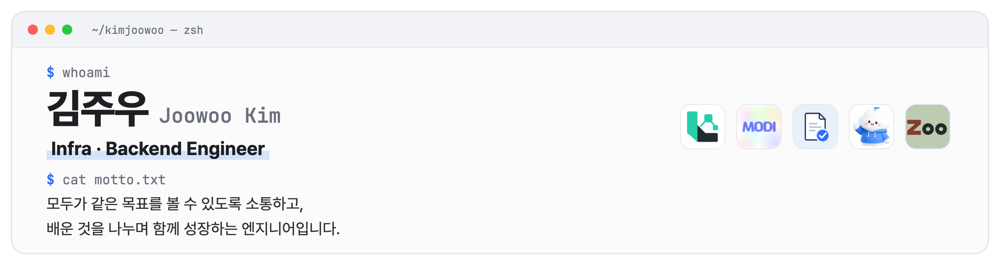
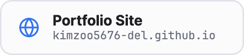
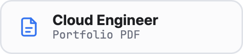
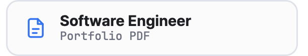
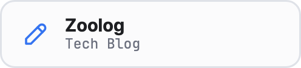
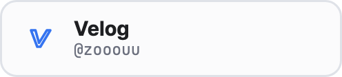
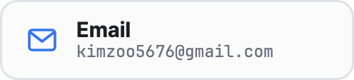
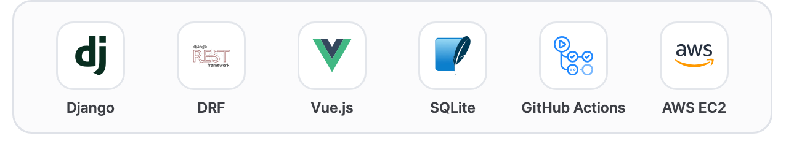

  
  
  
   
  
  
  

---

## 📚 Education

| 기간 | 소속 |
|------|------|
| 2019.03 - 2025.08 | 한양대학교 ERICA 경제학부 |
| 2026.01 - | 삼성청년SW·AI아카데미 SSAFY 15기 |

---

## 🚀 Projects

### 📰 NEW:LEARN — 기사 이슈 타임라인 · 기사 마인드맵 AI 플랫폼 &nbsp;`2026.10 - 2026.11`

  
  
  

> 뉴스를 AI로 구조화해 **사건과 이슈의 흐름**으로 보여 주는 서비스.
> SSAFY 2학기 프로젝트 · 6인 팀.

**Role** · Infra · BE

- **클러스터 구성** — 서버 2대를 WireGuard로 연결해 kubeadm 클러스터 하나로 운영, EC2 · 보안 그룹 · 백업 S3 버킷은 Terraform으로 관리
- **GitOps 배포** — MR 검사 → 이미지 빌드(Kaniko) → 배포 태그 MR → Argo CD 동기화, 롤백은 `git revert`
- **분석 작업 파이프라인** — 기사 분석을 Redis Streams 작업 큐로 API 응답과 분리, 동일 사건 판정은 PostgreSQL advisory lock으로 직렬화
- **기사 수집 · 적재** — 15분 주기 CronJob으로 뉴스 API 수집(중복 주소 제외), 기존 기사 79,335건은 카나리 100건 후 전체 적재
- **조회 성능** — 공개 기사 부분 인덱스로 기사 목록 p50 242ms → 22ms, 부하 테스트 포화 처리량 초당 93건 → 123건
- **묶기 정확도 평가** — 정답 라벨이 없는 사건 · 이슈 묶음을 LLM 채점과 사람 검수 200건으로 평가(B³ F1 사건 0.854 · 이슈 0.926)

 

### 📱 모디 (MODI) — 팀 목표 협업 앱 &nbsp;`2026.07 -`

  
  
  

> 방을 만들어 팀이 **목표 기간 동안 할 일 · 일정 · 자료를 공유**하는 iOS 협업 앱.
> App Store 출시 후 운영 중.

**Role** · Infra · BE · AI

- **CI/CD** — Oracle Cloud(ARM) 이관과 함께 GitHub Actions 워크플로로 재구성, 테스트를 통과한 코드만 배포
- **blue/green 배포** — 새 버전이 헬스체크를 통과한 뒤 Caddy로 트래픽 전환, 이전 버전 컨테이너는 롤백용으로 유지
- **백업 · 복구** — PostgreSQL과 파일 저장소(MinIO)를 매일 백업, 임시 컨테이너 복구로 테이블 20개 행 수 일치 확인
- **크롤링 파이프라인** — 사이트별 크롤러 분배, 실패를 재시도 대상 · 쿨다운 보류 · 확정 실패로 나눈 재시도와 Redis 쿨다운, 등록 시점 주소 검증
- **인스타그램 크롤러 장애** — 가설 6개를 하나씩 검증해 Java 클라이언트 접속 지문으로 원인을 확정, 호출 2곳만 HTTP/2 클라이언트로 교체
- **AI 할 일 추천** — 방에 모인 자료로 할 일 후보를 만드는 FastAPI 서버, 평가 러너로 변경마다 측정해 LLM 1회 호출 구조로 정리(앱 실측 평균 28.2초 → 11.8초, 각 3회)
- **iOS 릴리스** — TestFlight 배포와 App Store 심사 제출

 

### 🌌 Zoolog — 공부 기록 그래프 블로그 &nbsp;`2026.10 -`

  
  

> 공부한 글을 **주제별 그래프와 달력**으로 정리하는 개인 기술 블로그.
> 2026.10부터 운영 중.

**Role** · Infra · Full-Stack

- **GitOps 배포** — GitHub Actions(통합 테스트 → 이미지 빌드 → 매니페스트 태그 커밋)와 Argo CD로 k3s에 배포, 롤백은 `git revert`
- **로그인** — Google OIDC와 허용 이메일 하나로 본인만 글을 쓰게 하고, 서버 세션과 CSRF 보호 적용
- **글-이미지 연결 테이블** — 글 ID 컬럼 하나를 다대다 연결 테이블로 바꿔, 연결이 모두 끊긴 이미지만 유예 기간 뒤 정리
- **기사 메일 재발송** — 보낸 날 기록(UNIQUE)과 서버 시작 · 매시 정각 확인으로 서버가 꺼져 있던 날도 재발송

 

### 🏦 여보 (여신보좌관) — 기업여신 AI 업무 보조 서비스 &nbsp;`2026.08 - 2026.09`

  
  

> 은행 심사 담당자가 스타트업 법인의 서류 10종을 심사할 때 **서류 판독 → 서류 간 대조 → 위험 점검 → 등급 · 한도 → 심사의견서 초고**까지 보조하는 AI 서비스.
> SSAFY 2학기 프로젝트 · 5인 팀.

**Role** · Infra · BE

- **무중단 배포 · CI/CD** — Docker Swarm start-first 무중단 배포, Jenkins 자동 배포와 롤백, GitLab Runner CI 게이트(포맷 · 린트 · 테스트 · 빌드 · 시크릿 스캔)
- **관측** — Prometheus · Loki · Grafana로 지표와 컨테이너 로그를 수집해 운영 대시보드 구성
- **로그인 · 접근 제어** — SSAFY 통합인증, DB 세션, CSRF, TOTP 2차 인증, 담당자별 접근 제어와 감사부 열람
- **감사 로그** — SHA-256 해시 체인 · DB 권한 분리 · 트리거로 수정 · 삭제 차단, 체인 검증 API로 변조 위치 확인
- **값 계약 테스트** — 프론트 테스트가 백엔드 enum 파일을 직접 읽어 값과 순서를 비교, 어긋나면 머지 전 CI에서 실패

 

### 💰 OURWISH — 사회초년생을 위한 예·적금 추천 서비스 &nbsp;`2026.05 - 2026.06`

  
  

> 생성형 AI와 금융 데이터를 활용해 사용자에게 맞는 예·적금 상품을 추천하는 로보 어드바이저 서비스.
> **SSAFY 1학기 관통 프로젝트 최우수상 (서울2반 1등).**

**Role** · Infra · BE · AI

- **배포** — GitHub Actions로 CI/CD를 구성하고 AWS EC2(Nginx · Gunicorn)에 배포, 헬스체크 실패 시 직전 커밋으로 롤백
- **REST API · DB 설계** — DRF로 REST API와 JWT 인증 구현, 회원 · 상품 · 가입 · 찜 · 커뮤니티 5개 도메인 ERD 모델링
- **추천 파이프라인** — 금융감독원 API로 예·적금 상품 766건 수집, 우대조건을 태그 8개로 사전 구조화, 조건 필터링 후 세후 수령액 순 정렬
- **스트리밍 챗봇** — 상품 데이터로 답변 근거를 한정하고 SSE로 응답, 대화는 서버에 저장하지 않고 최근 5턴만 전달

---

## 🏆 Awards

| 날짜 | 수상 내역 |
|:---:|:---|
| `2026.07` | 삼성청년SW·AI아카데미 **SSAFY Race 대회 2위** Microsoft AirSim 기반 주행 봇 타임어택 — SSAFY 트랙 레이싱 라인·장애물 회피 최적화 |
| `2026.06` | 삼성청년SW·AI아카데미 1학기 관통 프로젝트 **최우수상** (서울2반 1등) **OURWISH** — 생성형 AI와 금융 데이터를 활용한 금융 상품 로보 어드바이저 서비스 |

---

## 🛠 Core Stack

